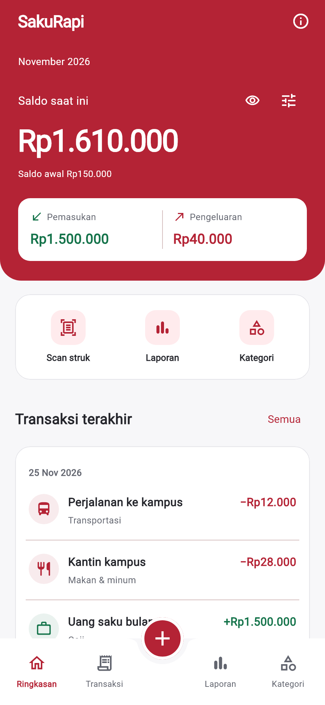
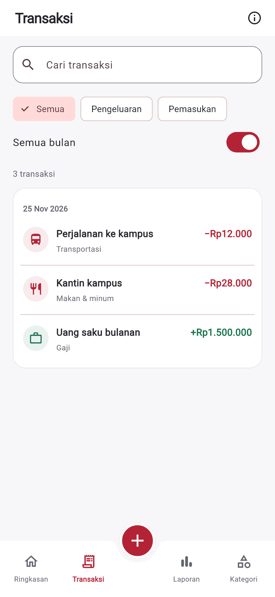
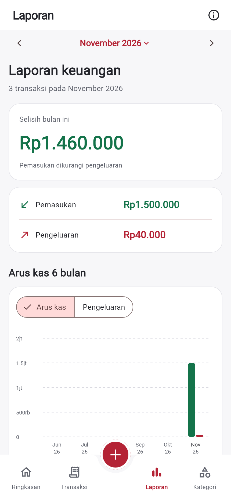
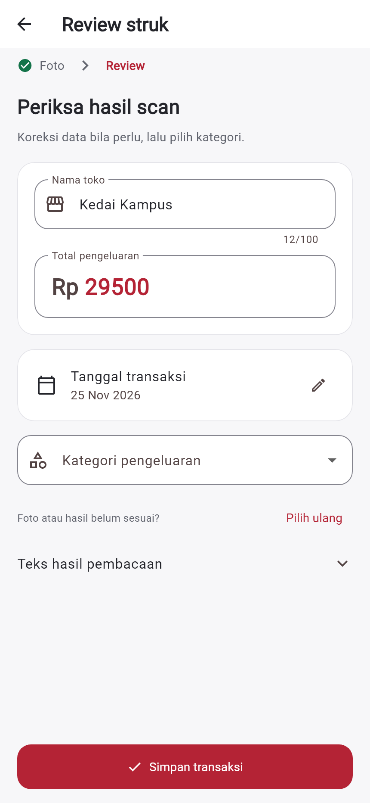

# SakuRapi

Aplikasi Android pencatat keuangan untuk tugas Pemrograman Mobile. Pengguna dapat mencatat pemasukan/pengeluaran, melihat saldo dan laporan, serta membaca struk belanja. Data tersimpan lokal menggunakan SQLite.

**Versi:** 1.1.1+3 · **Android:** 7.0/API 24 ke atas · **Penyimpanan:** lokal tanpa login/backend.

## APK siap dipasang

[Unduh SakuRapi 1.1.1](https://github.com/ekz121/sakurapi/raw/refs/heads/main/apk/SakuRapi-1.1.1.apk)

Unduh APK di HP, buka berkasnya, lalu izinkan pemasangan dari aplikasi pengunduh jika diminta Android. APK mencakup ARM 32-bit, ARM64, dan x86-64. Setelah dipasang, aplikasi dapat dipakai tanpa komputer. APK ini memakai debug signing untuk demonstrasi tugas; belum memakai signing produksi Play Store.

SHA-256 APK:

```text
ce39aa3352e094f5d62d6a7eb236c77b98706ee81b9e6362fcf4ab14408be6d6
```

## Fitur

- Tambah, lihat, ubah, dan hapus transaksi pemasukan/pengeluaran.
- Kategori dengan nama, jenis, warna, dan ikon.
- Saldo awal dan saldo berjalan; cari transaksi serta filter jenis/bulan.
- Laporan bulanan: pemasukan, pengeluaran, selisih, grafik enam bulan, dan rincian kategori.
- Kamera/galeri → baca struk → review/koreksi → pilih kategori → simpan pengeluaran.
- Data dan foto struk tetap tersedia setelah aplikasi ditutup.

Warna utama merah, pemasukan hijau, pengeluaran merah. Tampilan dan kode dibuat untuk SakuRapi; tidak memakai branding atau aset aplikasi referensi.

## Pratinjau

Gambar menggunakan data contoh pengujian, bukan data pengguna.

| Ringkasan | Transaksi |
|---|---|
|  |  |

| Laporan | Review struk |
|---|---|
|  |  |

## Teknologi

| Teknologi | Fungsi |
|---|---|
| Flutter dan Dart | Tampilan dan logika aplikasi. |
| `material_ui` | Komponen Material: tombol, formulir, dialog, navigasi. |
| SQLite dan `sqflite` | Database keuangan lokal. |
| Google ML Kit Text Recognition | OCR teks Latin dari foto, diproses di perangkat. |
| `image_picker` | Kamera dan pemilihan foto galeri. |
| `path`, `path_provider` | Lokasi penyimpanan foto struk. |
| `intl`, `flutter_localizations` | Format rupiah, tanggal, dan bahasa Indonesia. |
| `ChangeNotifier`, `AnimatedBuilder` | Memperbarui layar ketika data berubah. |
| `CustomPainter` | Grafik batang dan donat tanpa paket chart tambahan. |
| Flutter Test, Integration Test | Pengujian logika, database, antarmuka, dan OCR native. |
| `sqflite_common_ffi`, `sqflite_common_ffi_web` | Database untuk tes lokal dan pratinjau browser. |

Alat build: Flutter SDK, Android SDK/ADB, JDK, dan Gradle. Dependensi dan versinya tercatat di `pubspec.yaml` serta `pubspec.lock`.

## Struktur source

```text
lib/
  main.dart                 startup, tema, bahasa
  app_store.dart            state dan saldo
  domain/                   model, validasi rupiah, parser struk, laporan
  data/                     repository SQLite dan CRUD
  services/                 pembacaan struk dan penyimpanan foto
  ui/                       layar, formulir, navigasi, grafik
  preview_main.dart         entry point pratinjau browser
android/                    konfigurasi native, Gradle, ProGuard
web/                        pendukung database pratinjau browser
test/                       tes lokal dan antarmuka
integration_test/           tes OCR pada perangkat
docs/pratinjau/             gambar tampilan aplikasi
apk/                        APK demonstrasi siap instal
```

## Menyiapkan laptop dari nol

Lingkungan yang telah dipakai: Flutter 3.50.0, Dart 3.14.0, JDK 21, Android SDK API 36. Gunakan versi ini untuk mengikuti konfigurasi yang sudah diuji.

1. Pasang Git, [Flutter SDK](https://docs.flutter.dev/install), serta VS Code atau Android Studio.
2. Tambahkan folder `bin` Flutter ke PATH. Dart sudah termasuk Flutter SDK.
3. Ikuti [pengaturan Android](https://docs.flutter.dev/platform-integration/android/setup): pasang SDK API 36, Build Tools, Platform Tools, Command-line Tools, serta NDK/CMake yang dibutuhkan build melalui SDK Manager.
4. Siapkan JDK 21. Jika Flutter memilih Java yang berbeda, arahkan dengan `flutter config --jdk-dir "LOKASI_JDK_21"`; ganti lokasi sesuai laptop.
5. Periksa lingkungan dan setujui lisensi:

```bash
flutter --version
flutter doctor -v
flutter doctor --android-licenses
```

Internet diperlukan saat mengunduh SDK/dependensi dan build pertama. Pencatatan serta model OCR Latin pada APK berjalan lokal. Semua alat utama yang digunakan dapat dipakai gratis.

## Mengunduh dan menjalankan source

```bash
git clone https://github.com/ekz121/sakurapi.git
cd sakurapi
flutter pub get
flutter analyze
flutter test
```

Sambungkan HP memakai kabel data, aktifkan Developer Options dan USB debugging, lalu pilih Izinkan pada HP.

```bash
flutter devices
flutter run -d ID_HP
```

Ganti `ID_HP` dengan ID dari `flutter devices`. Terminal tetap terbuka: `r` hot reload, `R` hot restart, `q` berhenti. Perubahan plugin atau konfigurasi Android memerlukan berhenti dan run ulang. `unauthorized` berarti izin USB debugging perlu disetujui.

Konfigurasi `kotlin.incremental=false` disertakan agar cache kompilasi Kotlin tidak bermasalah ketika proyek dan cache dependensi berada di drive Windows yang berbeda. Fitur aplikasi tetap sama.

Pratinjau browser opsional:

```bash
flutter run -d chrome --target lib/preview_main.dart
```

OCR tidak tersedia di browser; data browser terpisah dari HP. Jika worker SQLite web perlu dibuat ulang, jalankan `dart run sqflite_common_ffi_web:setup`.

## Jika membangun aplikasi serupa secara manual

1. Tentukan fitur: CRUD, kategori, saldo, laporan, scan struk; buat sketsa empat tab dan tombol tambah.
2. Buat proyek dasar: `flutter create --platforms=android,web --org id.ac.mobile sakurapi`.
3. Tambahkan dependensi dari `pubspec.yaml`, lalu jalankan `flutter pub get`.
4. Buat model transaksi/kategori dan database di `data/finance_repository.dart`.
5. Buat CRUD dengan validasi nominal, tanggal, dan kategori. Hubungkan data ke layar melalui `AppStore`.
6. Buat ringkasan, daftar transaksi, pencarian, filter, dan editor kategori.
7. Hitung saldo serta laporan dari data tersimpan; gambar grafik berdasarkan total sebenarnya.
8. Hubungkan kamera/galeri ke ML Kit. Susun hasil OCR dengan `receipt_layout.dart`, lalu ambil total/tanggal/toko memakai `receipt_parser.dart`.
9. Buat layar review. Transaksi dan salinan foto baru disimpan setelah pengguna menekan Simpan.
10. Sesuaikan Android: application ID, minSdk 24, ikon, dan aturan ProGuard. Jangan menghilangkan aturan registrar ML Kit pada `android/app/proguard-rules.pro`.
11. Uji transaksi, perhitungan, layar kecil, dan OCR pada HP. Uji juga APK rilis karena hasil debug saja belum cukup.
12. Build APK, instal, lalu coba ulang alur utama.

Perintah `flutter create` hanya menghasilkan kerangka; fitur SakuRapi diimplementasikan pada source yang dijelaskan di atas.

## Database dan perhitungan

Database `sakurapi.db`, skema versi 1:

| Tabel | Data |
|---|---|
| `categories` | ID, nama, jenis, warna, ikon. |
| `entries` | ID, jenis, nominal, kategori, tanggal, toko, catatan, lokasi foto. |
| `settings` | Nilai pengaturan seperti saldo awal. |

Satu kategori memiliki banyak transaksi. Foreign key melindungi kategori yang masih dipakai. Nominal berupa INTEGER rupiah utuh; tanggal disimpan `YYYY-MM-DD`.

```text
Saldo = saldo awal + seluruh pemasukan − seluruh pengeluaran
Selisih bulanan = pemasukan bulan dipilih − pengeluaran bulan dipilih
Persentase kategori = total kategori / total jenis transaksi bulan itu × 100%
```

Contoh: Rp100.000 masuk − Rp51.000 keluar = Rp49.000. Saldo awal tidak termasuk pemasukan bulanan. Saldo negatif diperbolehkan.

## Alur OCR

Kamera/galeri → ML Kit menghasilkan teks → parser mengekstrak total, tanggal, toko → layar review → koreksi dan pilih kategori → simpan SQLite serta foto lokal.

OCR tidak selalu tepat. Foto yang buram atau format struk berbeda dapat memerlukan koreksi. Tanggal mengikuti struk: struk 4 Oktober 2024 muncul pada laporan Oktober 2024.

## Pengujian

Versi ini telah melewati 22 tes lokal dan analyzer tanpa isu. Layout diuji pada lebar 320/390/768, teks 200%, nominal besar, dan nama toko panjang. Kamera/galeri APK 1.1.1 telah dikonfirmasi berhasil pada Motorola Android 16; bukan klaim sudah diuji pada seluruh model HP.

Tes integrasi OCR bersifat opsional. `integration_test/receipt_ocr_test.dart` memerlukan foto fixture yang dapat diakses aplikasi uji dan berisi total 27.000, tanggal 4 Oktober 2024, toko Indomaret. Foto pribadi tidak disertakan dalam repository. Gunakan perangkat/instalasi khusus pengujian:

```bash
flutter test integration_test/receipt_ocr_test.dart -d ID_HP --no-uninstall --dart-define=OCR_FIXTURE=PATH_FOTO_YANG_DAPAT_DIAKSES_APLIKASI
```

Tanpa `--no-uninstall`, tes native dapat menghapus instalasi aplikasi dan catatan lokal. Jangan gunakan data keuangan penting untuk pengujian. Setelah tes native, lakukan build biasa tanpa `--no-pub` agar registrasi plugin pengujian diperbarui.

Kendala rilis yang diperbaiki: R8 sempat menghapus konstruktor registrar ML Kit sehingga OCR gagal pada APK. Aturan ProGuard mempertahankan konstruktor tersebut; perbaikannya disertakan di source.

## Membuat dan memasang APK sendiri

```bash
flutter build apk --release --target-platform android-arm,android-arm64,android-x64
```

Hasil: `build/app/outputs/flutter-apk/app-release.apk`. Kirim APK ke HP dan buka untuk memasangnya. Atau, jika ADB tersedia di PATH:

```bash
adb install -r build/app/outputs/flutter-apk/app-release.apk
```

`-r` memperbarui instalasi dengan application ID dan tanda tangan yang sama. Build di laptop lain membuat debug key berbeda, sehingga APK hasil build tersebut mungkin tidak dapat memperbarui APK bawaan repository. Jangan uninstall instalasi berisi data penting untuk mengatasi perbedaan tanda tangan. Keystore pribadi tidak disimpan di repository.

Panduan resmi tambahan: [build Android dan signing](https://docs.flutter.dev/deployment/android). Untuk rilis Play Store diperlukan signing produksi dan konfigurasi distribusi tersendiri.

## Urutan demo dan batasan

Demo: saldo awal → tambah pemasukan/pengeluaran → ubah/cari/hapus → kategori → laporan → scan/review/simpan → tutup dan buka ulang untuk menunjukkan persistensi data.

Belum ada ekspor cadangan, sinkronisasi, akun, atau integrasi bank. Uninstall/hapus data menghilangkan catatan lokal. Proyek saat ini ditargetkan untuk Android; folder browser untuk pratinjau, bukan dukungan OCR web atau APK iPhone.
